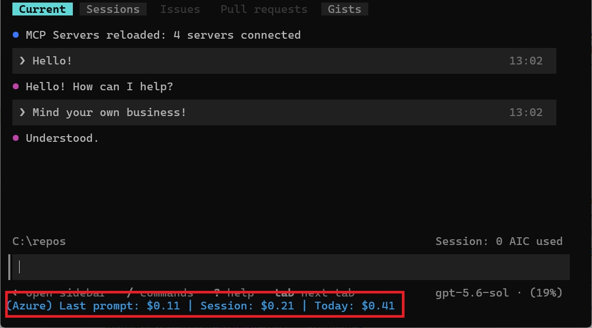

# Copilot CLI with Azure Foundry

This repo contains two helper scripts for using Azure Foundry-hosted models with GitHub Copilot CLI using BYOK (bring-your-own-key). They must be used together to work.

This is also the companion repo for the following blog post: [How to use Azure models in GitHub Copilot CLI and VS Code](https://daninacan.com/how-to-use-azure-models-in-github-copilot-cli-and-vs-code). Go there if you need to see how to deploy an Azure Foundry model and use it with GitHub Copilot.

See below for instructions. Each script has a Bash and a Powershell version for compatibility across different OS; pick whichever fits your environment. The two helper scripts are:

1. `copilot-azure`, a script that starts Copilot CLI with the needed environment variables so you don't have to type them out or copy-paste every time.

Before:

```bash
COPILOT_PROVIDER_TYPE=azure COPILOT_PROVIDER_BASE_URL=https://your-foundry-project-resource.openai.azure.com/openai/deployments/your-model-deployment COPILOT_PROVIDER_API_KEY=MyApiKey COPILOT_MODEL=your-model-deployment copilot
```

After:

```bash
copilot-azure your-model-deployment
```

You can run `copilot-azure` two ways. Firstly, without arguments, to select a model from the `model_key` column of the pricing CSV. Secondly, you can pass a deployment name directly, which must match a `model_key` in the CSV.

2. A custom status line script that shows Copilot's  spend in Azure from the Copilot CLI. This is what it looks like:



## 1. copilot-azure script

This script is essentially just a wrapper for the larger command above. To use it, follow these steps:

1. Place the script file(s) somewhere in your PATH.
    - For Windows using Powershell, copy both the .cmd and .ps1 file.
	- For macOS, Linux, and Windows using Bash, copy the Bash file (the one without an extension), then make it executable with `chmod +x /path/to/copilot-azure`.
2. This script needs the API key shown on your Azure Foundry project's landing page (since Copilot CLI needs it). Rather than storing it as plain text, the script gives you two options:
	- Set it in the `COPILOT_PROVIDER_API_KEY` environment variable.
	- Install the [Azure CLI](https://github.com/Azure/azure-cli) and be logged in. You will also need permission to list keys for the Azure Foundry resource. If `COPILOT_PROVIDER_API_KEY` isn't set, the script will instead fetch the API key from your account using the Azure CLI.

3. At the top of the script, set `AZURE_FOUNDRY_RESOURCE_NAME` to the Azure Foundry resource name used in your Foundry endpoint (eg, `https://<resource-name>.openai.azure.com`).

4. **Only needed if you are using the Azure CLI.** Set `AZURE_RESOURCE_GROUP_NAME` to the name of the resource group containing that resource.

## 2. Custom status line script for Azure spend

The custom status line script displays Foundry spend from the Copilot CLI. Since Foundry models are an external model provider, Copilot doesn't have any billing data for them. This status line script calculates and displays that.

To use it, follow the instructions below:

### 2.1 Windows with PowerShell

Copy the `azure-pricing-status-line` directory inside `~/.copilot` on your machine.

Then, in your `~/.copilot/settings.json`, add the following:

```json
{
	"statusLine": {
		"type": "command",
		"command": "~/.copilot/azure-pricing-status-line/statusline.cmd",
		"padding": 0
	}
}
```

See [this note from Scott Hanselman](https://gist.github.com/shanselman/9623ac74888a07ba82f63f5310fda11b) on why we wrap the Powershell in a .cmd:

> Why the wrapper? In testing, Copilot's statusLine.command setting was most reliable when it pointed at a command/script path. Putting pwsh -File ... directly in the JSON setting can be less reliable on Windows. The wrapper also preserves stdin, which is how Copilot sends the payload.

### 2.2 macOS, Linux, or Windows with Bash

The Bash implementation requires Node, so install that if you don't have it already. Copy the `azure-pricing-status-line` directory inside `~/.copilot` on your machine.

Make the status line script executable:

```bash
chmod +x ~/.copilot/azure-pricing-status-line/statusline.sh
```

Then, in your `~/.copilot/settings.json`, add the following:

```json
{
	"statusLine": {
		"type": "command",
		"command": "~/.copilot/azure-pricing-status-line/statusline.sh",
		"padding": 0
	}
}
```

### 2.3 Add pricing data
Finally, add pricing data to [foundry-model-pricing.csv](./azure-pricing-status-line/foundry-model-pricing.csv) from [Azure's model pricing page](https://azure.microsoft.com/en-us/pricing/details/ai-foundry-models/aoai/).

The script depends on you adding values to this file for whichever models you're using. It calculates the spend based on those numbers and the token usage data that Copilot CLI sends to the script. This allows the script to calculate spend without making any real API calls. A few rows exist already as an example.

When getting your model's pricing data from that page, make sure you choose the correct region and pricing tier.

You can also give each row any number of aliases (separate each one with a pipe `|`) to match on if you called your model deployment something besides the model name.